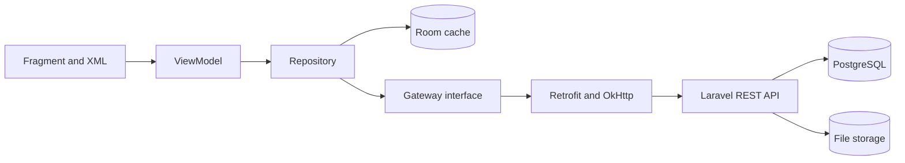

# Tàng Kinh Các Architecture

## Application Architecture

- Single-activity Android application
- Fragment and XML-based user interface
- MVVM presentation pattern
- Repository pattern for data access
- Room for local caching and offline data

## Backend Architecture

- Laravel REST API in a separate repository
- PostgreSQL as the authoritative structured data store
- Laravel Sanctum bearer tokens for mobile authentication
- Object or filesystem storage for covers, EPUB files, and audiobook files
- Retrofit and OkHttp as the Android API client

## Data Flow

## Backend Capabilities

- Account registration, login, logout, and authenticated profile access
- Book, author, and genre metadata
- Authorized EPUB discovery and download
- Audiobook metadata and ordered audio-track access

Community, rankings, payments, and other domain capabilities will be added behind new gateways when their
requirements are implemented.

## Detailed Design

The gateway boundaries, request flows, data ownership, and initial relational model are defined in
[Laravel Backend Architecture Decision](laravel_backend_architecture.md).
