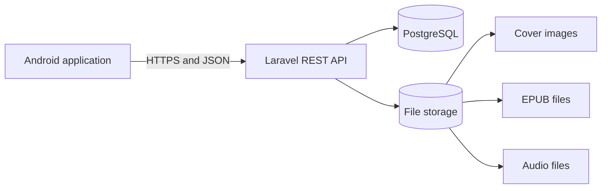

# Backend Requirements Specification

- **Project:** Tang Kinh Cac
- **Status:** Approved for implementation
- **Version:** 1.0
- **Date:** 2026-11-13
- **Audience:** Backend engineers, Android engineers, reviewers, and testers
- **Related decision:** [Laravel Backend Architecture Decision](laravel_backend_architecture.md)

## 1. Purpose

This document defines the implementation requirements for the Tang Kinh Cac backend. It is the contract between
the Android application and the server implementation. Backend engineers must be able to design, implement, and
test the first server version from this specification without depending on Firebase behavior.

The first version establishes four stable capabilities:

1. User registration and token-based authentication.
2. Book, author, and genre metadata discovery.
3. Authorized EPUB discovery and download.
4. Audiobook metadata, ordered tracks, streaming, and download information.

Later domains such as community, rankings, reading progress, payments, and administration are outside this version.
They must be added through new versioned endpoints without breaking the contracts defined here.

The words **must**, **must not**, **should**, and **may** express requirement priority.

## 2. Goals

- Provide one trusted server-side owner for authentication, authorization, validation, and content access.
- Expose a stable REST API to the Android application over HTTPS and JSON.
- Store structured data and relationships in PostgreSQL.
- Store cover images, EPUB files, and audio files outside PostgreSQL.
- Support local development on Windows without requiring Docker.
- Keep the implementation small enough for one developer to understand and operate.
- Preserve clean Android boundaries through domain-focused gateways.

## 3. Non-Goals

Version 1 does not include:

- Firebase compatibility or data migration.
- A public website or server-rendered frontend.
- An administration dashboard.
- Community posts, comments, reactions, or follows.
- Reading or listening progress synchronization.
- Rankings or analytics aggregation.
- Payments, subscriptions, or book ownership.
- Real-time events, WebSockets, Redis, or microservices.
- EPUB parsing, digital rights management, or audio transcoding.

VIP metadata remains visible, but VIP content access is denied until an entitlement system is specified.

## 4. Required Technology

| Area | Requirement |
| --- | --- |
| Language | PHP supported by the selected Laravel release |
| Framework | Current stable Laravel release |
| API style | Versioned REST over HTTPS and JSON |
| Authentication | Laravel Sanctum personal access tokens |
| Database | PostgreSQL |
| ORM and migrations | Eloquent and Laravel migrations |
| File access | Laravel filesystem abstraction |
| Android client | Retrofit and OkHttp |
| Local cache | Room in the Android repository |
| API documentation | OpenAPI 3 specification committed with the backend |
| Testing | PHPUnit or Pest feature and unit tests |

The backend must be maintained in a repository separate from the Android application.

## 5. System Context



The Laravel API is the only component allowed to make authorization decisions. Android input is untrusted. Room is
a replaceable client cache and must never be treated as the authoritative source of server data.

## 6. Backend Repository Requirements

The repository must include at least:

```text
app/
bootstrap/
config/
database/
  factories/
  migrations/
  seeders/
openapi/
  openapi.yaml
routes/
  api.php
storage/
tests/
  Feature/
  Unit/
.env.example
composer.json
README.md
```

The README must document:

- Required PHP version and extensions.
- Composer installation.
- Native PostgreSQL setup.
- Environment configuration.
- Database creation, migration, and seeding.
- Local server startup.
- Test and formatting commands.
- Local file-storage location.
- Android Emulator and physical-device base URLs.

Docker files may be added later but must not be required for local development.

## 7. Local Development Requirements

The backend must run with native PHP, Composer, and PostgreSQL. A clean setup must require no more than these
project commands after prerequisites and the database are installed:

```powershell
composer install
Copy-Item .env.example .env
php artisan key:generate
php artisan migrate --seed
php artisan storage:link
php artisan serve --host=0.0.0.0 --port=8000
```

The expected development base URLs are:

```text
Windows host:     http://127.0.0.1:8000/api/v1/
Android Emulator: http://10.0.2.2:8000/api/v1/
Physical device:  http://<host-lan-ip>:8000/api/v1/
```

Production and release builds must use HTTPS. Local HTTP support is a debug-only Android concern.

The initial queue connection may be `sync`. Redis and a persistent queue worker are not required for version 1.

## 8. API Conventions

### 8.1 Versioning

All application endpoints must use the `/api/v1` prefix. Health checks may live outside authentication but remain
under the same version prefix.

Breaking request or response changes require a new API version. Adding an optional response field is not breaking.

### 8.2 Content Type

Requests and responses must use UTF-8 JSON unless an endpoint returns binary content.

```http
Accept: application/json
Content-Type: application/json
```

### 8.3 Field Naming

JSON fields must use `snake_case`. Database columns must also use `snake_case`. Timestamps must use ISO 8601 UTC.

```text
2026-11-13T08:30:00Z
```

### 8.4 Success Envelope

Single-resource response:

```json
{
  "data": {
    "id": 1,
    "title": "The Tale of Kieu"
  }
}
```

Collection response:

```json
{
  "data": [],
  "meta": {
    "current_page": 1,
    "per_page": 20,
    "total": 0,
    "last_page": 1
  }
}
```

Endpoints returning `204 No Content` must not include a response body.

### 8.5 Error Envelope

All application errors must use a stable machine-readable code:

```json
{
  "error": {
    "code": "VALIDATION_ERROR",
    "message": "The request contains invalid fields.",
    "fields": {
      "email": ["The email field must be a valid email address."]
    },
    "request_id": "01JD0EXAMPLE"
  }
}
```

- `code` must be stable and safe for Android branching.
- `message` must be safe to show or replace with a localized Android string.
- `fields` may be omitted when no field-specific error exists.
- `request_id` must identify the related server log entry.
- Production responses must not expose stack traces, SQL, paths, or exception class names.

### 8.6 Required Status Codes

| Status | Meaning |
| --- | --- |
| `200` | Successful read or update |
| `201` | Resource created |
| `204` | Successful operation without a response body |
| `400` | Malformed request |
| `401` | Missing, invalid, or revoked authentication token |
| `403` | Authenticated user lacks permission or content access |
| `404` | Resource does not exist or is not visible |
| `409` | Unique or state conflict |
| `422` | Validation failure |
| `429` | Rate limit exceeded |
| `500` | Unexpected server failure |

### 8.7 Pagination

Collection endpoints must accept:

| Parameter | Default | Rules |
| --- | --- | --- |
| `page` | `1` | Integer greater than zero |
| `per_page` | `20` | Integer from `1` through `50` |

Invalid pagination values must return `422 VALIDATION_ERROR`.

## 9. Security Requirements

- Passwords must be hashed by Laravel's password hashing facilities and never logged or returned.
- Access tokens must be generated by Sanctum and stored hashed by the backend.
- Protected endpoints must use `auth:sanctum`.
- Login and registration endpoints must be rate-limited.
- Database, storage, and application secrets must come from environment variables.
- `.env`, credentials, private keys, and production content must not be committed.
- User enumeration must be minimized. Login failures use one `INVALID_CREDENTIALS` result.
- Authorization failures must not reveal private storage paths.
- File paths supplied by clients must never be passed directly to the filesystem.
- Uploaded or seeded files must have validated type, size, and checksum metadata.
- CORS must be disabled unless a browser client is deliberately introduced.
- Logs must not contain passwords, bearer tokens, full EPUB content, or audio bytes.

## 10. Authentication Requirements

### 10.1 User Fields

| Field | Requirements |
| --- | --- |
| `full_name` | Required string, trimmed, 2 to 100 characters |
| `username` | Required, 4 to 20 characters, letters, digits, period, or underscore |
| `username_normalized` | Lowercase server-generated username used for uniqueness |
| `birth_date` | Required ISO date, not in the future |
| `phone_number` | Required, normalized to optional `+` followed by 9 to 15 digits |
| `email` | Required valid email, normalized to lowercase, unique |
| `password` | Required string, 8 to 128 characters |
| `role` | Server-controlled value, initially `reader` or `admin` |

The Android validation rules must be updated to match the server rule of at least eight password characters.

### 10.2 Register

```http
POST /api/v1/auth/register
```

Request:

```json
{
  "full_name": "Nguyen Van An",
  "username": "reader.one",
  "birth_date": "1990-06-15",
  "phone_number": "+84901234567",
  "email": "reader@example.com",
  "password": "correct-horse-battery-staple",
  "password_confirmation": "correct-horse-battery-staple"
}
```

Behavior:

- Normalize email, username, and phone number on the server.
- Create the user inside one database transaction.
- Return `409 EMAIL_ALREADY_USED` for an existing normalized email.
- Return `409 USERNAME_ALREADY_USED` for an existing normalized username.
- Return `422 VALIDATION_ERROR` for other invalid fields.
- Return `201` with the created user resource and no access token.
- Registration must not authenticate the user; the Android flow returns to login after successful registration.

Success response:

```json
{
  "data": {
    "user": {
      "id": 1,
      "full_name": "Nguyen Van An",
      "username": "reader.one",
      "birth_date": "1990-06-15",
      "phone_number": "+84901234567",
      "email": "reader@example.com",
      "role": "reader"
    }
  }
}
```

### 10.3 Login

```http
POST /api/v1/auth/login
```

Request:

```json
{
  "email": "reader@example.com",
  "password": "correct-horse-battery-staple",
  "device_name": "Pixel 9"
}
```

Success response:

```json
{
  "data": {
    "token": "plain-text-token-returned-once",
    "token_type": "Bearer",
    "user": {
      "id": 1,
      "full_name": "Nguyen Van An",
      "username": "reader.one",
      "birth_date": "1990-06-15",
      "phone_number": "+84901234567",
      "email": "reader@example.com",
      "role": "reader"
    }
  }
}
```

Invalid credentials return `401 INVALID_CREDENTIALS`. The response must not indicate whether the email exists.

### 10.4 Current User

```http
GET /api/v1/auth/me
Authorization: Bearer <token>
```

Return `200` with the authenticated user resource or `401 UNAUTHENTICATED`.

### 10.5 Logout

```http
POST /api/v1/auth/logout
Authorization: Bearer <token>
```

The endpoint must revoke only the current access token and return `204`.

## 11. Catalog Requirements

### 11.1 Book List

```http
GET /api/v1/books
Authorization: Bearer <token>
```

Supported query parameters:

| Parameter | Purpose |
| --- | --- |
| `q` | Search titles, alternative titles, authors, genres, synopsis, and keywords |
| `genre` | Filter by genre slug |
| `country` | Filter by normalized country code or stored country value |
| `access_level` | `free` or `vip` |
| `sort` | `title`, `newest`, or `rating` |
| `page` | Pagination page |
| `per_page` | Pagination size |

Only books with status `published` are visible to reader accounts. Search must be case-insensitive and
accent-insensitive. The implementation may use PostgreSQL `unaccent` or normalized searchable values, but this
behavior is part of the API contract and must be covered by tests.

Each list item must include:

```json
{
  "id": 1,
  "slug": "truyen-kieu",
  "title": "Truyen Kieu",
  "author": {
    "id": 1,
    "name": "Nguyen Du"
  },
  "country": "Vietnam",
  "access_level": "free",
  "status": "published",
  "average_rating": "4.9",
  "review_count": 1200,
  "cover_url": "https://example.test/media/...",
  "has_epub": true,
  "has_audiobook": false
}
```

### 11.2 Book Detail

```http
GET /api/v1/books/{book}
Authorization: Bearer <token>
```

`{book}` may resolve by numeric identifier or unique slug. The response must include all list fields plus:

- Original title.
- Alternative titles.
- Author original name.
- Original language.
- Publication period.
- Genres.
- Structure description.
- Historical setting.
- Synopsis.
- Keywords.
- Available content types.

Missing, draft, or archived books return `404 BOOK_NOT_FOUND` to reader accounts.

### 11.3 Genre List

```http
GET /api/v1/genres
Authorization: Bearer <token>
```

Return all active genres ordered by name. Each genre includes `id`, `slug`, `name`, and `published_book_count`.

### 11.4 Books by Genre

```http
GET /api/v1/genres/{genre}/books
Authorization: Bearer <token>
```

The endpoint follows the same visibility, pagination, and list-resource rules as `GET /books`.

## 12. EPUB Requirements

### 12.1 EPUB Descriptor

```http
GET /api/v1/books/{book}/epub
Authorization: Bearer <token>
```

Success response:

```json
{
  "data": {
    "file_id": 10,
    "book_id": 1,
    "version": 1,
    "mime_type": "application/epub+zip",
    "size": 2457600,
    "checksum_sha256": "64-character-lowercase-hex-digest",
    "download_url": "https://example.test/api/v1/media/10/download?...",
    "expires_at": "2026-11-13T08:35:00Z"
  }
}
```

Requirements:

- The selected file must be an active EPUB belonging to a published book.
- The file MIME type must be `application/epub+zip`.
- The checksum must be calculated when the file enters storage, not for every request.
- The download URL must be signed, short-lived, and must not reveal the storage path.
- The default signed URL lifetime is five minutes.
- Free content is accessible to authenticated readers.
- VIP content returns `403 CONTENT_ACCESS_DENIED` until entitlements are implemented.
- Missing EPUB content returns `404 EPUB_NOT_FOUND`.

### 12.2 EPUB Download

```http
GET /api/v1/media/{file}/download?expires=...&signature=...
```

The endpoint must validate the signature and expiration before returning bytes. It should provide:

```http
Content-Type: application/epub+zip
Content-Length: <size>
Content-Disposition: attachment; filename="<safe-name>.epub"
ETag: "<checksum>"
```

The server must stream the file and must not load the complete EPUB into PHP memory.

## 13. Audiobook Requirements

### 13.1 Audiobook Descriptor

```http
GET /api/v1/books/{book}/audiobook
Authorization: Bearer <token>
```

Return the book identifier, title, cover URL, total duration, track count, and availability. Missing audiobook
content returns `404 AUDIOBOOK_NOT_FOUND`.

### 13.2 Audio Tracks

```http
GET /api/v1/books/{book}/audio-tracks
Authorization: Bearer <token>
```

Tracks must be ordered by `sort_order` ascending. Each track includes:

```json
{
  "id": 21,
  "title": "Chapter 1",
  "sort_order": 1,
  "duration_seconds": 1240,
  "mime_type": "audio/mpeg",
  "size": 18200000,
  "checksum_sha256": "64-character-lowercase-hex-digest",
  "stream_url": "https://example.test/api/v1/audio-tracks/21/stream?...",
  "expires_at": "2026-11-13T08:35:00Z"
}
```

VIP access follows the same rule as EPUB access.

### 13.3 Audio Stream

```http
GET /api/v1/audio-tracks/{track}/stream?expires=...&signature=...
```

The media response must support HTTP byte-range requests so Android can seek without downloading the entire file.
Valid range requests return `206 Partial Content` and the required range headers. Invalid or expired signatures
return `403 INVALID_MEDIA_SIGNATURE`.

The server or storage provider must stream audio without loading the entire file into PHP memory.

## 14. Initial Relational Model

### 14.1 `users`

| Column | Type | Constraints |
| --- | --- | --- |
| `id` | Big integer | Primary key |
| `full_name` | String | Required |
| `username` | String | Required |
| `username_normalized` | String | Required, unique |
| `birth_date` | Date | Required |
| `phone_number` | String | Required |
| `email` | String | Required, unique after normalization |
| `password` | String | Required, hashed |
| `role` | String | Required, default `reader` |
| `email_verified_at` | Timestamp | Nullable |
| `created_at` | Timestamp | Required |
| `updated_at` | Timestamp | Required |

Sanctum owns the `personal_access_tokens` table.

### 14.2 `authors`

| Column | Type | Constraints |
| --- | --- | --- |
| `id` | Big integer | Primary key |
| `name` | String | Required, indexed |
| `original_name` | String | Nullable |
| `biography` | Text | Nullable |
| `created_at` | Timestamp | Required |
| `updated_at` | Timestamp | Required |

### 14.3 `books`

| Column | Type | Constraints |
| --- | --- | --- |
| `id` | Big integer | Primary key |
| `author_id` | Big integer | Foreign key to `authors` |
| `slug` | String | Required, unique |
| `title` | String | Required, indexed |
| `original_title` | String | Nullable |
| `country` | String | Required, indexed |
| `original_language` | String | Nullable |
| `publication_period` | String | Nullable |
| `structure` | String | Nullable |
| `historical_setting` | Text | Nullable |
| `synopsis` | Text | Required |
| `access_level` | String | `free` or `vip`, indexed |
| `status` | String | `draft`, `published`, or `archived`, indexed |
| `average_rating` | Decimal | Default `0.0` |
| `review_count` | Unsigned integer | Default `0` |
| `published_at` | Timestamp | Nullable |
| `created_at` | Timestamp | Required |
| `updated_at` | Timestamp | Required |

### 14.4 Supporting Catalog Tables

- `genres`: `id`, unique `slug`, unique `name`, `is_active`, timestamps.
- `book_genre`: unique pair of `book_id` and `genre_id` with foreign keys.
- `book_alternative_titles`: `id`, `book_id`, `title`, and a unique pair of book and title.
- `book_keywords`: `id`, `book_id`, `value`, and a unique pair of book and value.

### 14.5 `book_files`

| Column | Type | Constraints |
| --- | --- | --- |
| `id` | Big integer | Primary key |
| `book_id` | Big integer | Foreign key to `books`, indexed |
| `type` | String | `cover`, `epub`, or `audio`, indexed |
| `title` | String | Nullable; required for audio tracks |
| `storage_disk` | String | Required |
| `storage_path` | String | Required, unique, private |
| `original_filename` | String | Required |
| `mime_type` | String | Required |
| `size` | Unsigned big integer | Required, bytes |
| `checksum_sha256` | String | Required, 64 lowercase hexadecimal characters |
| `version` | Unsigned integer | Required, default `1` |
| `sort_order` | Unsigned integer | Nullable; required for audio tracks |
| `duration_seconds` | Unsigned integer | Nullable; required for audio tracks |
| `is_active` | Boolean | Required, default `true` |
| `created_at` | Timestamp | Required |
| `updated_at` | Timestamp | Required |

Foreign keys must use explicit delete behavior. Deleting a book with attached files should be rejected; books should
normally be archived instead. Storage deletion must never happen implicitly through a database cascade.

## 15. Seed Data Requirements

The development seeder must provide:

- One reader account with a documented non-production password.
- One admin account with a documented non-production password.
- The eight current Android catalog books.
- Authors, genres, alternative titles, and keywords required by those books.
- At least one free book with a sample EPUB.
- At least one free book with two ordered sample audio tracks.
- At least one VIP book for denied-access tests.

Seed data must use redistributable or project-owned sample media. Copyrighted production files must not be committed.

## 16. Code Organization and Quality

Controllers must remain thin. They may validate through Form Request objects, call focused domain actions when
business logic is non-trivial, and return API Resources. Business rules must not be placed in route closures.

Expected namespaces include:

```text
App\Http\Controllers\Api\V1
App\Http\Requests\Api\V1
App\Http\Resources\Api\V1
App\Models
```

The implementation must not introduce generic `BaseRepository`, `BaseService`, or response-wrapper hierarchies.
Eloquent may be used directly for straightforward CRUD. A service or action class is justified only when a workflow
contains real business rules, transactions, or coordination across storage systems.

Additional requirements:

- Use strict types in project PHP files where compatible with Laravel conventions.
- Use typed properties, parameters, and return values.
- Use enums or validated constants for status, access level, file type, and role.
- Use database constraints in addition to application validation.
- Do not use raw SQL when the query builder or Eloquent is clear and safe.
- Do not expose Eloquent models directly; return API Resources.
- Keep user-facing and machine-readable errors separate.
- Follow PSR-12 and the formatter configured by the backend project.

## 17. Logging and Operations

- Every request must receive or generate a request identifier.
- Unexpected exceptions must be logged with request identifier, route, status, and authenticated user ID when known.
- Authentication failures may be counted but must not log submitted credentials.
- Health checks must verify application availability without exposing secrets.
- Database backup and production monitoring are deployment concerns, but configuration must remain environment-driven.

Health endpoint:

```http
GET /api/v1/health
```

Success response:

```json
{
  "data": {
    "status": "ok"
  }
}
```

The health endpoint is public and must not disclose framework, database, host, or storage credentials.

## 18. Testing Requirements

Every endpoint must have feature tests covering its applicable cases:

- Successful request.
- Missing authentication.
- Invalid or revoked token.
- Validation failure.
- Resource not found.
- Authorization or content-access denial.
- Rate limiting for authentication endpoints.
- Correct response envelope and status code.

Additional required tests:

- Registration normalizes email, username, and phone number.
- Duplicate normalized email and username are rejected.
- Passwords are never returned, and tokens are returned only by the login endpoint.
- Reader accounts cannot see draft or archived books.
- Catalog filtering and pagination are deterministic.
- EPUB descriptors never expose storage paths.
- Expired and modified media signatures fail.
- EPUB downloads stream the expected bytes and headers.
- Audio range requests return correct `206` responses.
- VIP EPUB and audio access are denied.
- Foreign key and uniqueness constraints are enforced.

Tests must use isolated test data and must not call production services.

Required quality commands must be documented in the backend README and run in CI. At minimum, CI must install
dependencies, run formatting checks, run static analysis if configured, migrate a test database, and execute tests.

## 19. OpenAPI Requirements

`openapi/openapi.yaml` must describe every public endpoint in this specification, including:

- Parameters and authentication requirements.
- Request and response schemas.
- Error responses and stable error codes.
- Pagination metadata.
- File descriptor schemas.
- Example requests and responses.

The OpenAPI document and implementation must be reviewed together. An endpoint is incomplete when either its code
or its OpenAPI contract is missing.

## 20. Acceptance Criteria

Version 1 is accepted when all conditions below are true:

- The project installs and runs locally on Windows without Docker.
- PostgreSQL migrations create the complete schema from an empty database.
- Seeders produce a usable development catalog and sample accounts.
- Registration, login, current-user lookup, and logout work through Sanctum.
- Published books can be listed, searched, filtered, paginated, and opened.
- Draft and archived books are hidden from readers.
- A free EPUB descriptor and signed download work end to end.
- Free audiobook tracks can be listed and streamed with byte-range support.
- VIP content is denied with the specified error.
- All responses follow the documented envelopes and error codes.
- Storage paths and secrets never appear in API responses.
- Feature tests and code-quality checks pass.
- The OpenAPI contract matches the running implementation.
- The Android team can implement all four initial gateways without reading backend source code.

## 21. Expected Android Gateways

The final server contract must be sufficient for these Android boundaries:

```text
AuthGateway
  register
  login
  logout
  getCurrentUser

BookCatalogGateway
  getBooks
  getBook
  getGenres
  getBooksByGenre

BookContentGateway
  getEpubDescriptor

AudiobookGateway
  getAudiobook
  getAudioTracks
```

Retrofit DTOs, HTTP responses, and transport errors must be mapped inside Android data-layer implementations. The
server must not require Android UI code to understand Laravel, Sanctum, PostgreSQL, or the selected storage provider.
