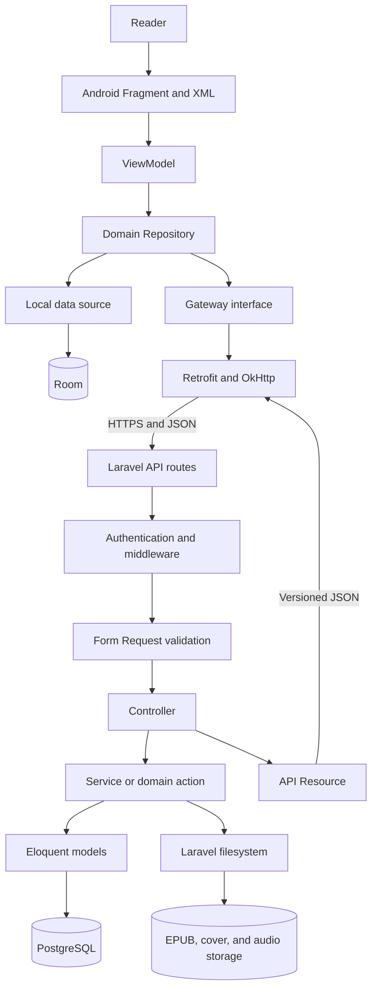
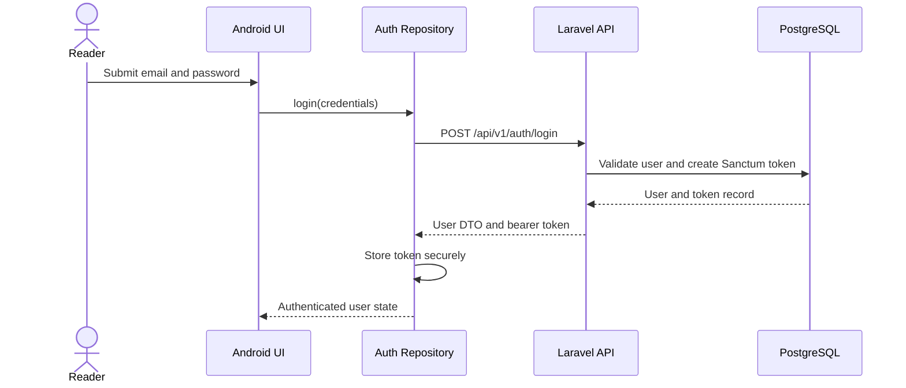
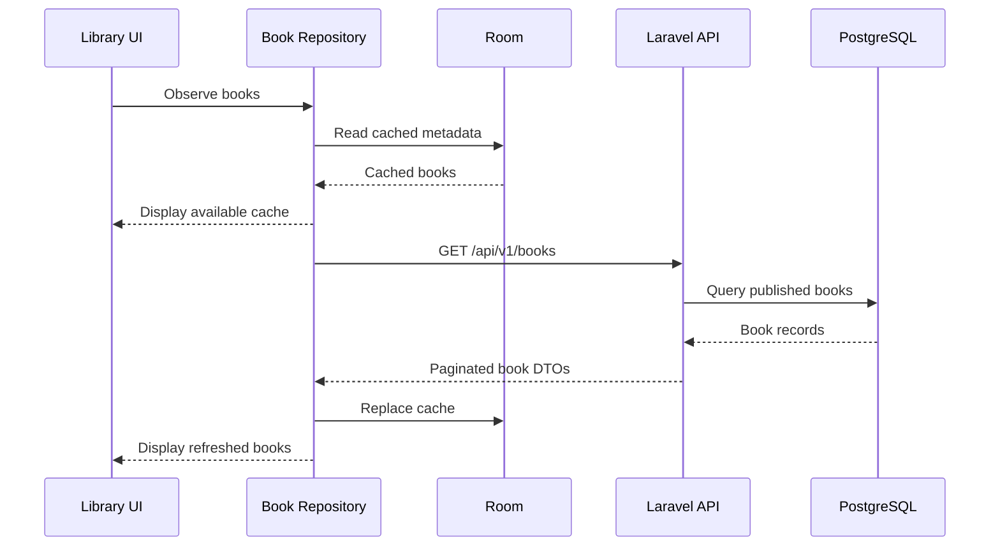
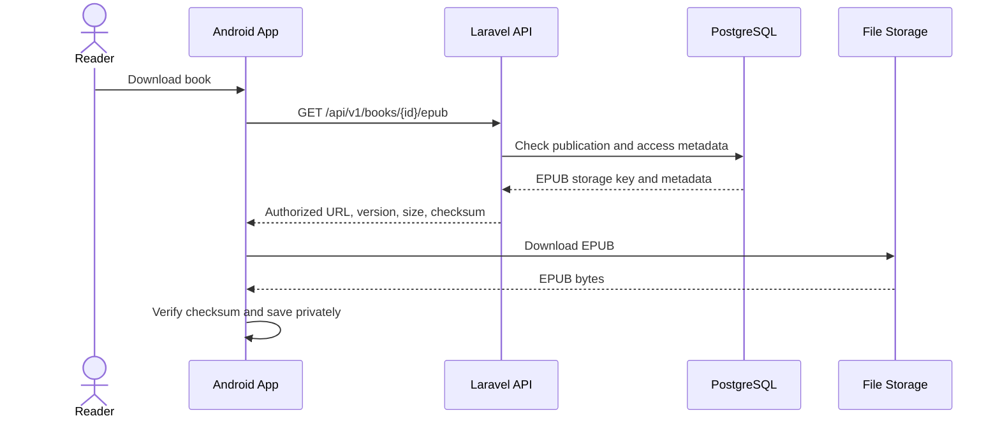
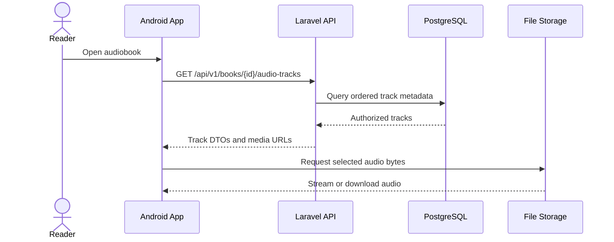
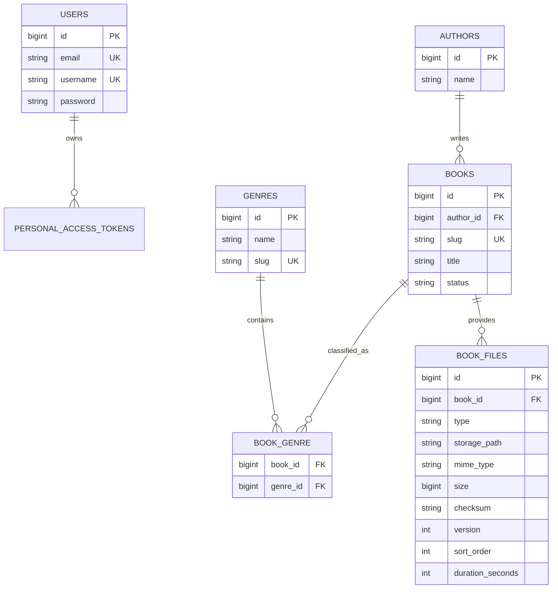

# Laravel Backend Architecture Decision

- **Status:** Accepted
- **Date:** 2026-11-13
- **Scope:** Backend ownership, structured data, authentication, book metadata, EPUB content, and audiobooks
- **Supersedes:** [Hybrid Data Storage Decision](hybrid_data_storage.md)

## Why Firebase Is Being Removed

Tang Kinh Cac is growing from a client prototype into a system that must own its domain rules. Books, authors,
genres, user access, reading progress, audiobook tracks, community activity, rankings, and future ownership or
payment records are related data. Keeping those rules inside Android clients and Firebase-specific security rules
would make the system harder to reason about, test, report on, and extend.

Firebase is therefore being removed from the target architecture for the following reasons:

1. **Domain ownership:** authentication, authorization, validation, and business rules must have one trusted
   server-side owner.
2. **Relational data:** PostgreSQL provides explicit relationships, constraints, transactions, and aggregate
   queries for the data Tang Kinh Cac is expected to manage.
3. **Stable application contract:** a versioned REST API prevents Android screens from depending on a database
   vendor or its SDK types.
4. **Independent evolution:** the backend can add moderation, reporting, content access, ranking, and ownership
   rules without distributing those rules across mobile clients.
5. **Testability and reproducibility:** migrations, seed data, API tests, and local infrastructure can describe the
   complete backend behavior without requiring a Firebase project.
6. **Controlled infrastructure:** storage location, deployment, backups, monitoring, and database access remain
   explicit project decisions instead of implicit dependencies on Firebase products.

This decision accepts additional server operation and security work in exchange for control over the domain and
its data.

## Decision

The backend will be developed in a separate repository as a Laravel REST API. PostgreSQL will be the authoritative
store for structured data. Laravel Sanctum will issue bearer tokens to the Android client. Covers, EPUB files, and
audiobook files will be stored outside PostgreSQL through Laravel's filesystem abstraction.

The Android application will use Retrofit and OkHttp to call the API. Repositories will coordinate remote gateways
with Room, which remains responsible for local cache and offline state. Fragments and ViewModels must not access
Retrofit, Room, Laravel-specific response types, or storage URLs directly.

## Expected Architecture



## Responsibility Boundaries

| Component | Responsibility |
| --- | --- |
| Android UI | Render state and forward user actions. |
| ViewModel | Coordinate screen behavior and expose immutable UI state. |
| Repository | Choose remote or cached data and map transport models into application models. |
| Gateway | Define one domain-focused remote API contract. |
| Room | Cache metadata, download state, and offline data owned by the device. |
| Laravel API | Validate requests, authenticate users, enforce authorization, and execute domain rules. |
| PostgreSQL | Own structured and relational application data. |
| File storage | Own cover images, EPUB files, and audiobook binaries. |

## Initial Gateways

These are the first stable Android-to-backend boundaries. They are intentionally small; later features must add
new operations only when their requirements exist.

### Auth Gateway

**Purpose:** establish and revoke an authenticated mobile session and return the current user.

```http
POST /api/v1/auth/register
POST /api/v1/auth/login
POST /api/v1/auth/logout
GET  /api/v1/auth/me
```

The gateway returns application-level authentication results. Laravel exceptions, raw HTTP responses, and
bearer-token details must not escape into the UI layer.

### Book Catalog Gateway

**Purpose:** provide searchable book, author, and genre metadata without exposing content files.

```http
GET /api/v1/books
GET /api/v1/books/{bookId}
GET /api/v1/genres
GET /api/v1/genres/{genreId}/books
```

The books endpoint may accept search, genre, country, access-level, and pagination parameters. The API remains the
source of truth; Room contains a replaceable local cache.

### Book Content Gateway

**Purpose:** authorize access to an EPUB edition and provide the information required for a safe download.

```http
GET /api/v1/books/{bookId}/epub
```

The response identifies the edition version, file size, checksum, and an authorized download URL. PostgreSQL stores
file metadata and a storage key, never the EPUB binary. Android verifies the checksum before marking a download as
available offline.

### Audiobook Gateway

**Purpose:** describe an audiobook and expose its ordered audio tracks for streaming or offline download.

```http
GET /api/v1/books/{bookId}/audiobook
GET /api/v1/books/{bookId}/audio-tracks
GET /api/v1/audio-tracks/{trackId}/stream
```

Track metadata includes its order, title, duration, size, checksum, and authorized media URL. The initial gateway
does not define playback state or synchronization; those behaviors will be added when the player is implemented.

## Expected Authentication Flow



## Expected Catalog and Cache Flow



## Expected EPUB Download Flow



## Expected Audiobook Flow



## Initial Data Model



`BOOK_FILES.type` initially distinguishes `cover`, `epub`, and `audio`. Audio-specific columns may be null for
non-audio files. A separate audiobook schema should be introduced only when narration, editions, or track-level
requirements outgrow this initial model.

## Design Constraints

- All endpoints are versioned under `/api/v1`.
- All protected endpoints enforce authentication and resource authorization on the server.
- Validation failures use stable machine-readable error codes and field errors.
- Binary files are never stored in PostgreSQL columns or JSON responses.
- Android stores downloaded files only in app-private storage.
- Repository interfaces must not expose Retrofit responses, Eloquent models, or storage-provider types.
- Database schema changes are performed through Laravel migrations.
- Backend behavior is covered by API feature tests, including unauthorized and invalid requests.
- Secrets, bearer tokens, database credentials, and storage credentials are never committed or logged.

## Deferred Capabilities

The initial architecture does not require community persistence, ranking aggregation, payments, real-time events,
Redis, WebSockets, a search service, or microservices. Each may be added behind a focused gateway when a concrete
feature requires it. Their absence must not cause domain logic to return to the Android client.

## Expected Result

After this decision is implemented:

- Android can develop against stable domain gateways without any Firebase SDK.
- Laravel is the trusted owner of authentication, authorization, validation, and content-access rules.
- PostgreSQL is the source of truth for structured data and relationships.
- Room provides replaceable local cache and offline state rather than a second source of truth.
- EPUB and audio delivery can move between local, S3-compatible, or other storage without changing Android domain
  interfaces.
- New backend capabilities can be introduced as endpoints and gateways without restructuring the existing UI.
